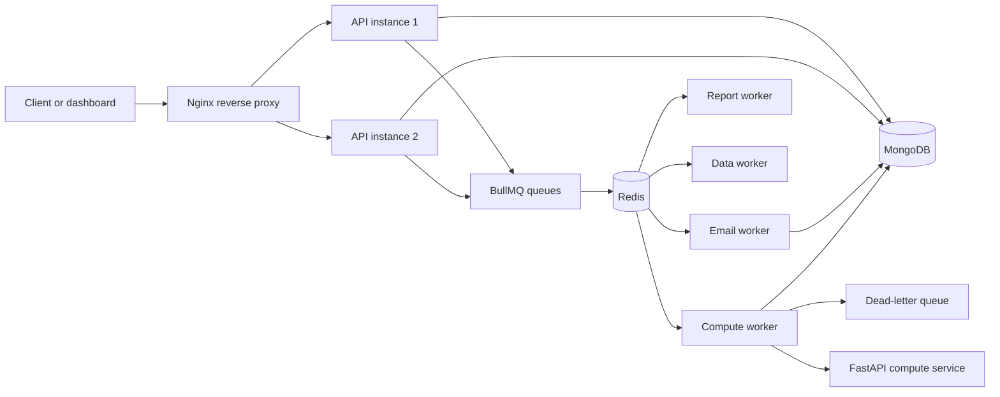

<div align="center">
  

  # FluxGrid

  **Move workloads. Scale workers. Observe the flow.**

  A distributed job-processing control plane for submitting asynchronous workloads, routing them through durable queues, and executing them on independently scalable workers.

  <p>
    <a href="#local-development">Quick start</a> ·
    <a href="#architecture">Architecture</a> ·
    <a href="#api-surface">API surface</a> ·
    <a href="#roadmap">Roadmap</a>
  </p>
</div>

<p align="center">
  
  
  
  
  
  
</p>

## What is FluxGrid?

FluxGrid separates request handling from execution. A client submits a job to the API, the API records it in MongoDB and places it on a BullMQ queue backed by Redis, and a worker consumes the job independently of the request lifecycle.

That separation is useful for workloads that are bursty, slow, failure-prone, or expensive to execute synchronously. It gives the platform a clear place to add worker capacity, retry transient failures, retain failed work in a dead-letter queue, and expose operational state to a control-plane UI.

FluxGrid is currently an engineering-focused foundation: the queueing path, worker processes, compute service, container topology, and dashboard surfaces are present, while several product-level capabilities remain under active implementation.

## Why it exists

Synchronous request handlers are a poor fit for long-running or bursty work. They tie API capacity to execution time, make retries harder to reason about, and give operators limited visibility into what is waiting or failing.

FluxGrid addresses that shape of problem with:

- **Durable hand-off:** jobs are persisted before they are dispatched.
- **Queue isolation:** email, report, data, and compute workloads use separate BullMQ queues.
- **Independent execution:** workers can scale separately from API instances.
- **Failure handling:** queue attempts use exponential backoff; exhausted compute jobs are copied to a dead-letter queue.
- **Operational foundation:** health endpoints, structured service boundaries, Docker health checks, and an initial dashboard surface are included.

## Implemented today

### Core processing

- Express API with `GET /health` and `POST /api/v1/jobs`.
- MongoDB job persistence through Mongoose.
- BullMQ queues for `email`, `report`, `data`, and `compute` workloads.
- Three attempts with exponential backoff for API-enqueued jobs.
- Node worker processes for email and compute queues.
- Compute processor retry bookkeeping and dead-letter hand-off after the final attempt.
- Python FastAPI compute service with `/health` and `/compute`.
- Graceful worker shutdown handling for `SIGTERM` and `SIGINT`.

### Platform and UI foundation

- pnpm monorepo with shared types, constants, validators, configuration, and logging packages.
- React/Vite dashboard and public-site surfaces.
- Role and permission configuration in the web application for `SUPER_ADMIN`, `ORG_ADMIN`, `OPERATOR`, `ANALYST`, and `GUEST`.
- Dashboard surfaces for jobs, queues, workers, analytics, administration, developer tooling, and settings.
- Docker Compose topology with MongoDB, Redis, two API instances, four worker instances, Nginx, and the Python compute service.
- k6 scenario definitions for baseline, stress, and staged heavy-load testing.

## In progress

The codebase already exposes the UI and permission model, but these areas are not yet represented as a complete production authentication/authorization system:

- Connecting the web auth context to a backend identity service.
- Completing authenticated API routes and server-side RBAC enforcement.
- Completing job read, status, result, cancellation, and retry endpoints beyond job submission.
- Wiring dashboard data to live API and worker telemetry.
- Completing report, data, and email worker flows end to end.
- Publishing reproducible benchmark output from the committed k6 scenarios.

## Screenshots

No product screenshots are currently committed to the repository. The README intentionally does not use placeholders or unrelated imagery. When representative FluxGrid captures are available, this section should show the landing page, dashboard, job explorer, queue/worker view, and job details in a compact two-column layout.

## Architecture



### Component responsibilities

| Component | Responsibility |
| --- | --- |
| React web app | Public pages and dashboard surfaces for jobs, queues, workers, analytics, administration, and developer tooling. |
| Nginx | Routes traffic across the two API containers. |
| Express API | Accepts job submissions, persists job records, and dispatches jobs to BullMQ queues. |
| MongoDB | Stores job records and execution metadata. |
| Redis | Provides the BullMQ transport and queue state. |
| Node workers | Consume queue messages and run workload processors with bounded concurrency. |
| FastAPI compute service | Provides the Python compute boundary used by the compute workload. |
| Dead-letter queue | Retains exhausted compute jobs with error context and attempt information. |

## How a job moves through FluxGrid

1. A client sends `POST /api/v1/jobs` with a supported `type` and payload.
2. The API creates a `pending` MongoDB job record.
3. The API selects the matching BullMQ queue: `email`, `report`, `data`, or `compute`.
4. BullMQ stores the queued job in Redis with three attempts and exponential backoff.
5. A matching worker consumes the job independently of the API request.
6. The worker processor performs the workload and records execution metadata where implemented.
7. Successful jobs are completed; exhausted compute jobs are copied to `dead-letter` with the original data, error, attempt count, and timestamp.

## Technology stack

| Layer | Technology |
| --- | --- |
| Web | React 19, Vite, React Router, Tailwind CSS, Zustand, TanStack Query, Recharts |
| API | Node.js 22, TypeScript, Express 5 |
| Persistence | MongoDB with Mongoose |
| Queueing | Redis with BullMQ and ioredis |
| Compute service | Python 3.13, FastAPI, Pydantic, Uvicorn |
| Validation and security foundations | Zod, Helmet, CORS, bcryptjs, JSON Web Token dependency |
| Observability foundation | Pino and pino-http dependencies |
| Infrastructure | Docker, Docker Compose, Nginx |
| Testing and load tooling | Vitest, Supertest, Playwright, ESLint, k6 scenario files |
| Workspace | pnpm 12 monorepo |

## Repository structure

```text
FluxGrid/
├── apps/
│   ├── api/              # Express API, MongoDB model, BullMQ dispatch
│   ├── compute-python/   # FastAPI compute boundary
│   ├── web/              # React/Vite public site and dashboard
│   └── worker/           # BullMQ queues, processors, and workers
├── packages/
│   ├── config/           # Shared configuration package
│   ├── constants/        # Queue, job-type, and role constants
│   ├── logger/           # Shared logger package
│   ├── shared-types/     # Shared TypeScript contracts
│   └── validators/       # Shared request validators
├── infrastructure/
│   ├── docker/            # Service Dockerfiles
│   ├── nginx/             # Reverse-proxy configuration
│   └── scripts/           # Cleanup, seed, and load-test helpers
├── tests/
│   └── load/              # k6 baseline, stress, and heavy scenarios
├── docker-compose.yml
├── pnpm-workspace.yaml
└── pnpm-lock.yaml
```

## API surface

### Health check

```http
GET /health
```

Returns the API service health payload.

### Queue a job

```http
POST /api/v1/jobs
Content-Type: application/json
```

Supported job types in the API dispatch path are `email`, `report`, `data`, and `compute`.

Example:

```json
{
  "type": "compute",
  "payload": {
    "number": 10
  }
}
```

Successful submission returns `202 Accepted` with the created `jobId` and `queued` status. The current API is intentionally small; job retrieval and authenticated management endpoints are part of the implementation roadmap.

## Roles and permissions

The web application defines the following role model:

| Role | Intended responsibility |
| --- | --- |
| `SUPER_ADMIN` | Full platform administration, including organizations, roles, system configuration, users, queues, workers, jobs, and audit views. |
| `ORG_ADMIN` | Organization-level management of jobs, queues, workers, users, API keys, analytics, reports, and audit views. |
| `OPERATOR` | Day-to-day job, queue, worker, analytics, and report operations without organization-wide administration. |
| `ANALYST` | Read-only operational visibility plus report export and analytics access. |
| `GUEST` | Limited dashboard, job, report, and profile access for external or restricted users. |

The role and permission configuration is implemented in the web application. Backend authentication and server-side authorization enforcement are not yet complete, so this model should not be treated as a finished security boundary.

## Retry and dead-letter behavior

Jobs submitted through the API are configured for three attempts with exponential backoff beginning at one second. Completed jobs are retained by BullMQ up to the configured completion limit; failed jobs are not automatically removed.

The compute worker listens for failures. Once a compute job reaches its configured attempt limit, it adds a dead-letter record containing the original job ID and data, error message, attempt count, and failure timestamp. Email failure logging exists; full retry/DLQ behavior for every workload type remains in progress.

## Local development

### Prerequisites

- Node.js 22+
- pnpm 12.8.1
- MongoDB and Redis, or Docker
- Python 3.13 only when running the compute service locally
- k6 only when running load scenarios

### Install

```bash
pnpm install
```

### Start the Node development processes

```bash
pnpm dev
```

This starts the API and worker development commands in parallel. The web app can be started separately:

```bash
pnpm --filter @fluxgrid/web dev
```

### Build and test

```bash
pnpm build
pnpm test
pnpm lint
```

The repository currently has Vitest scripts in the worker package and build/lint scripts across the workspace; test coverage varies by package.

## Docker Compose

The Compose topology starts:

- MongoDB with a persistent `mongodb_data` volume.
- Redis with health checks.
- Two API containers behind Nginx on port `8080`.
- Four worker containers.
- The Python compute service on port `8000`.

Start the stack:

```bash
docker compose up --build
```

Useful endpoints:

| Endpoint | Service |
| --- | --- |
| `http://localhost:8080/health` | API through Nginx |
| `http://localhost:8000/health` | Python compute service |
| `http://localhost:8080/api/v1/jobs` | Job submission |

Stop the stack:

```bash
docker compose down
```

Worker replicas are represented explicitly in `docker-compose.yml` (`worker-1` through `worker-4`). API horizontal routing is configured in `infrastructure/nginx/nginx.conf`.

## Environment configuration

Compose supplies the core service configuration directly to containers:

| Variable | Used by | Compose value |
| --- | --- | --- |
| `NODE_ENV` | API and workers | `production` |
| `PORT` | API | `3000` |
| `REDIS_HOST` | API and workers | `redis` |
| `REDIS_PORT` | API and workers | `6379` |
| `MONGO_URI` | API and workers | `mongodb://mongodb:27017/fluxgrid` |
| `PYTHON_ENV` | Compute service | `production` |

For local process execution, provide equivalent values in an ignored `.env` file. No `.env.example` is currently committed, so local environment documentation should be treated as a follow-up task.

## Performance and load scenarios

The repository contains k6 scenario definitions, not committed result output:

| Scenario | Configuration | Purpose |
| --- | --- | --- |
| Baseline | 250 VUs for 10 seconds | Checks that job submission returns `202`. |
| Stress | 50 VUs for 30 seconds | Sustained email-job submission. |
| Heavy | Ramps to 500 VUs, holds for 1 minute, then ramps down | Exercises staged high concurrency with thresholds of `<5%` request failures and `<500 ms` p95 request duration. |

Run a scenario against the Compose stack, for example:

```bash
k6 run tests/load/stress.js
```

These are acceptance thresholds and test configurations, not measured performance claims. Reproducible result artifacts should be added before publishing throughput or success-rate numbers.

## Production deployment considerations

The Compose setup demonstrates the intended topology and horizontal scaling shape. Before production use, complete and verify:

- Backend authentication, authorization, tenant isolation, and secret management.
- Durable job status/result APIs and idempotency behavior.
- Production MongoDB and Redis persistence, backup, access control, and TLS.
- Centralized logs, metrics, tracing, and alerting.
- CI/CD, image publishing, vulnerability scanning, and deployment manifests.
- Reproducible k6 results under the target infrastructure.

## Roadmap

### Implemented

- Queue-backed job submission.
- MongoDB job records.
- Redis/BullMQ queue separation.
- Node worker processes and compute retry/DLQ path.
- Python compute service.
- Docker Compose API and worker scaling topology.
- React dashboard and role/permission UI foundation.

### Planned

- Complete authenticated API and backend RBAC.
- Add job list, detail, status, result, cancel, and retry endpoints.
- Connect dashboard views to live operational data.
- Finish report, data, and email processing flows.
- Add production observability and deployment automation.
- Publish benchmark results and add representative product screenshots.

## Contributing

Keep changes scoped to the relevant app or shared package, preserve the workspace boundaries, and update the documentation when behavior or service topology changes. Run the smallest relevant build, test, and lint commands before opening a pull request.

## License

The repository currently declares the ISC license in its root `package.json`. Add a `LICENSE` file if the project is intended for distribution under that license.

## Author

Built by [Zain Abbas](https://github.com/Zain-Abbas-developer).
